

# P.I.L.L.A.R.S

**Parkinson's Intelligent Living, Long-term AIoT Remote Supervision**
A wristband that notices a fall or a freeze, a home hub that hands out the right pills to the right person,
and a caregiver app that sees both, even when the house loses its Internet.

 

> [!NOTE]
> Team **MLIoT – Edgelectronix**, FPT IoT Challenge 2026 (*Smart Healthcare with Edge AI*, with Silicon Labs),
> May to September 2026. **First Runner-Up** at the Grand Final in Hanoi. This repo is a **showcase**;
> the firmware, Station and Cloud source are private.

> [!IMPORTANT]
> P.I.L.L.A.R.S provides **structured monitoring data only**. It does not diagnose Parkinson's disease,
> does not replace clinical care, and never changes a medication or a dose by itself. Every detected
> event (fall, freeze, cough, missed dose) is a *possible*, model-estimated indicator with a confidence
> score, not a clinical finding.

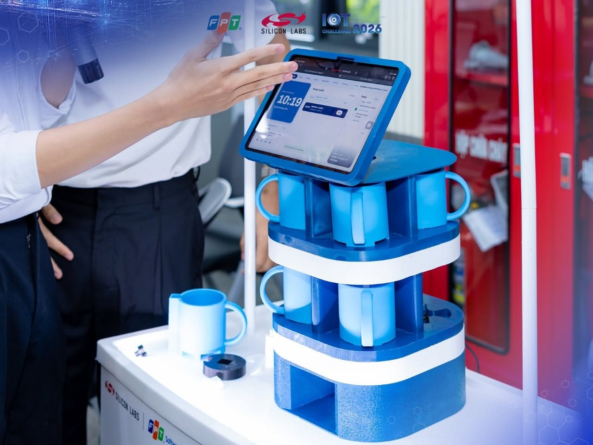

The P-Station at the Grand Final: eight medication cups in two layers, the pickup cup at the front, the kiosk on top.

 

## 🏆 Result

### **First Runner-Up**, FPT IoT Challenge 2026 Grand Final ✅

Out of the Top 10 finalists, at the Grand Final & Award Ceremony in Hanoi on **18 September 2026**.

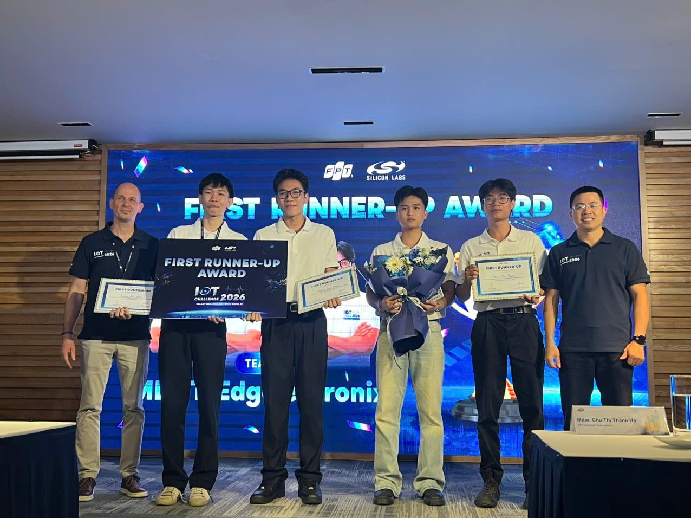

 

## 🧠 The problem

People with Parkinson's live on a tight medication clock. Levodopa wears off between doses (the
"OFF" periods), and that is when freezing of gait and falls get more likely. Families can't watch all
day, and clinic visits only see a 15-minute snapshot.

P.I.L.L.A.R.S tries to close that gap at home:

1. **Take the right pills on time**: a dispenser that only opens for the right person, at the right time
2. **Notice what happens between doses**: a wristband that flags a possible fall, freeze or SOS on its own
3. **Tell someone**: a caregiver app with a live feed, alerts and the history a doctor can actually read

 

## 👥 Team

**MLIoT – Edgelectronix**, two Electrical-Electronic and two Robotics & Mechatronics engineering students.

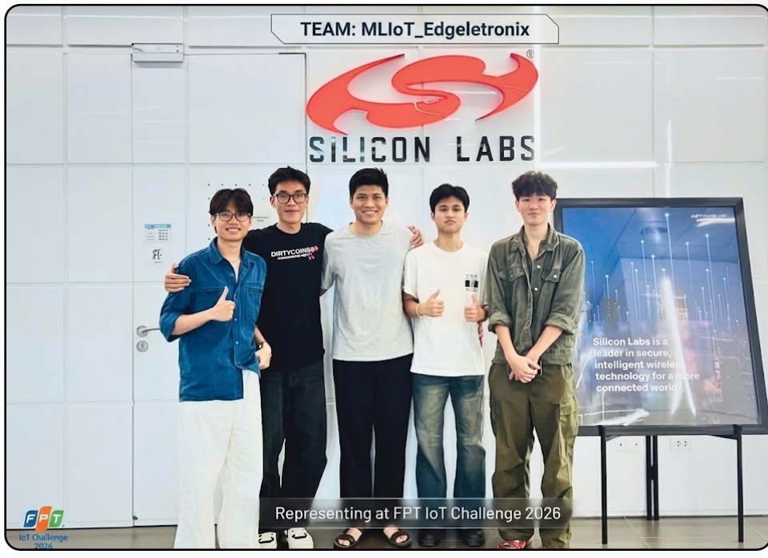

| | Who | What |
| :--- | :--- | :--- |
| 🧠 | **Đặng Như Phước** (lead) | Fall, fall-direction and freezing-of-gait models, the voice and cough model, wristband firmware, Cloud backend and caregiver app, Station pairing and the BLE pipeline |
| 💊 | **Trương Gia Bảo** (me) | Fall-detection dataset collection, pill dispenser hardware and firmware (2 × ESP32 motor layers, Pi-side IR counting, cup-pickup sensor), bench bring-up, the Station's smart-home kiosk UI |
| 🖥️ | **Huỳnh Trọng Khiêm** | Raspberry Pi Station backend, kiosk dose flow, dispense scheduling and status LEDs, prescription reading, the LAN-only demo fallback |
| 🔌 | **Hồ Minh Thao** | Wearable hardware (sensors, MCUs, mic, buzzer), power and charging, schematics and PCBs, the movement safety dashboard and 3D patient twin |

 

## 📷 The build

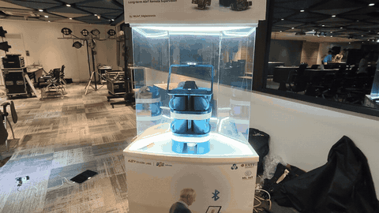

The Station in its display case, set up at the venue the night before the final.

<table>
<tr>
<td width="50%" align="center">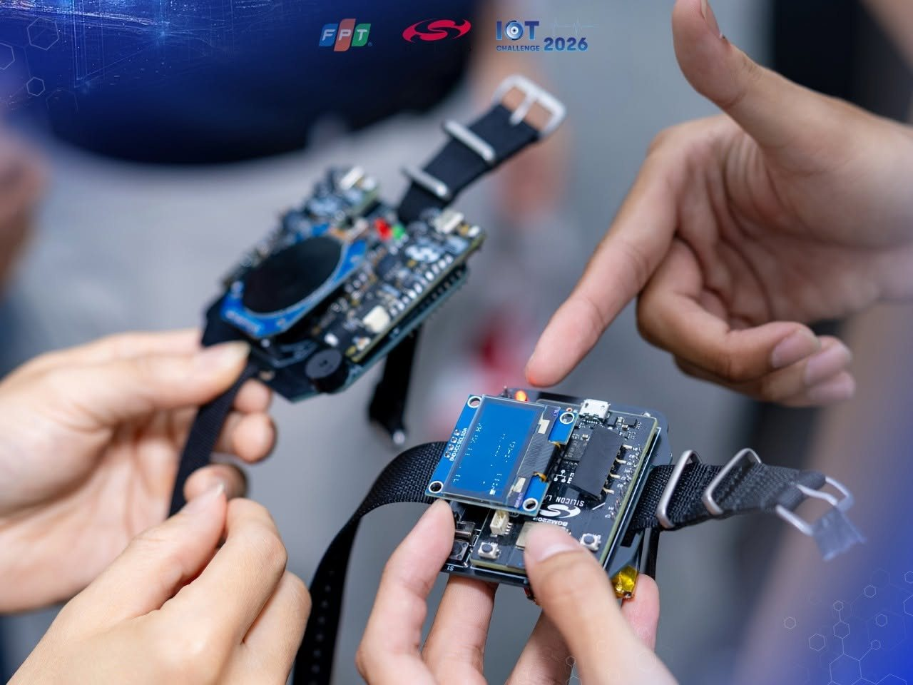 The P-Wearable prototypes on their straps</td>
<td width="50%" align="center">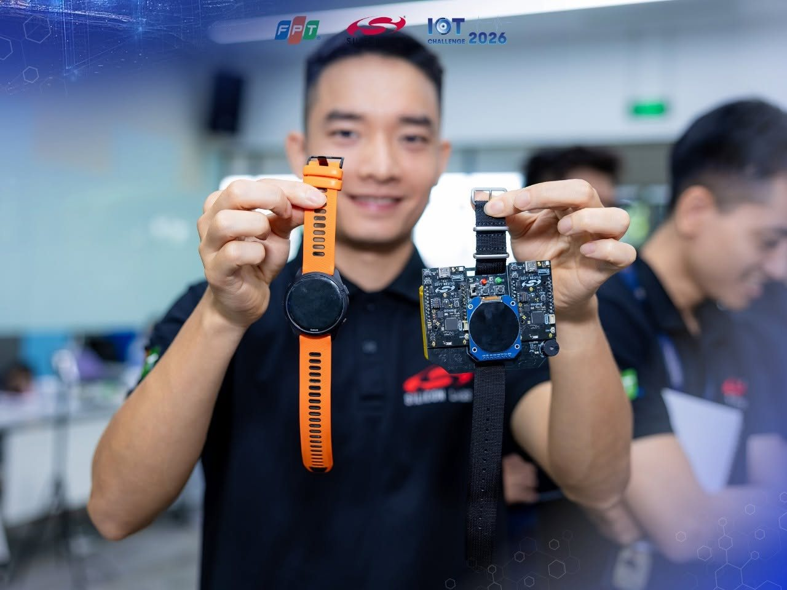 The wristband at the booth</td>
</tr>
</table>

<table>
<tr>
<td width="50%" align="center">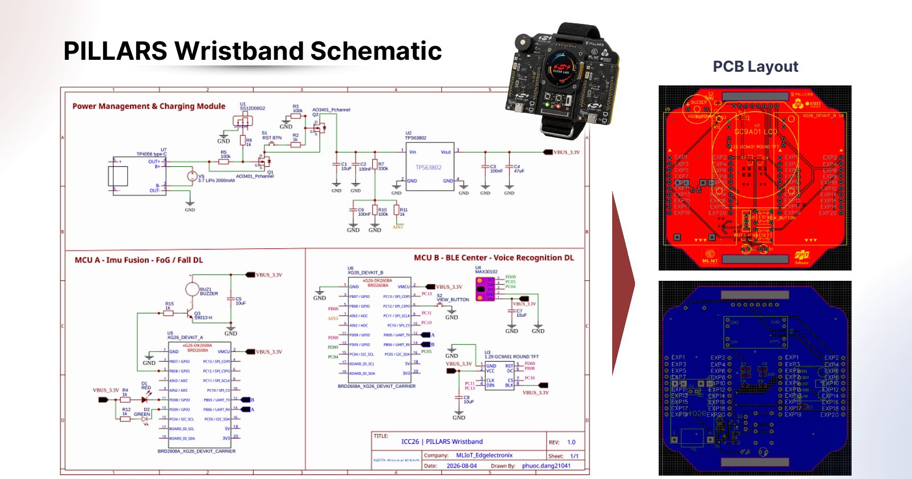 Wristband schematic and PCB: power, MCU A (IMU fusion, fall / FoG), MCU B (BLE, voice)</td>
<td width="50%" align="center">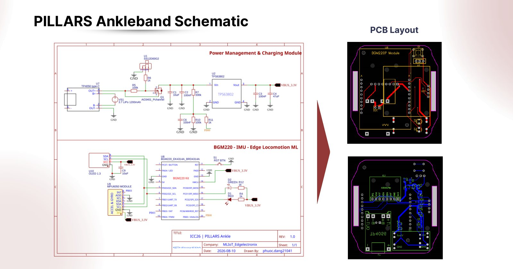 Ankle band schematic and PCB: BGM220 + IMU</td>
</tr>
</table>

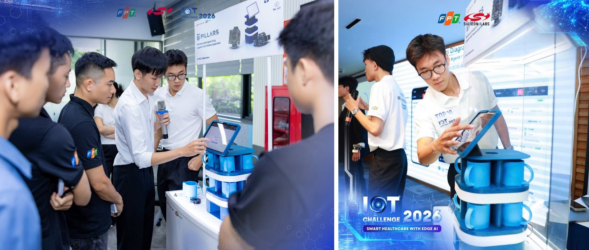

Demoing the Station to judges and visitors at the booth.

 

## 🏗️ Three tiers, one rule

**The Cloud decides, the home executes, every event is written down before it travels.**

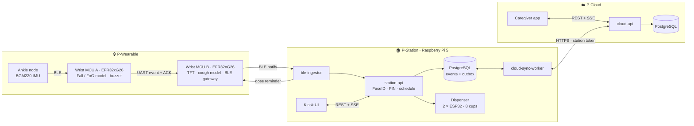

| Tier | Owns | Keeps working without… |
| :--- | :--- | :--- |
| **P-Wearable** | Sensing and the first, fastest decision: fall, freeze, SOS, cough | the Pi and the Internet: the buzzer fires on the wrist |
| **P-Station** | Who is standing in front of it, which pills are due, turning the motors, writing every event locally | the Internet: dispensing, alerts and the kiosk all run offline |
| **P-Cloud** | Accounts, patients, consent, confirmed medication plans, long-term history, caregiver alerts | nothing; it's the source of truth the Station caches |

 

## ⌚ The wristband

A wristband with **two Silicon Labs EFR32xG26 MCUs** and an ankle node:

- **MCU A** pairs with the ankle IMU, fuses both, and runs the **fall and freezing-of-gait** models
  on-device. It drives the buzzer itself, so a fall alarm never waits on Bluetooth or Wi-Fi.
- **MCU B** is the gateway: it takes compact events from MCU A over UART, listens on its microphone
  for **"help", "good" and coughs**, draws on a round GC9A01 TFT, and serves BLE to the Station.
- In normal use it sends **events, not raw streams**. Raw IMU (10 Hz, 20-byte samples) is a debug and
  dataset-collection switch only.

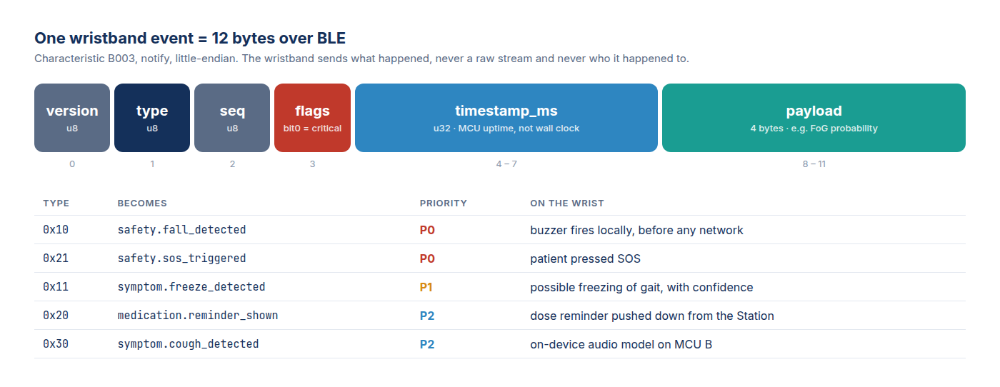

The wristband never knows **who** is wearing it. The Cloud owns the wrist ↔ patient assignment and
syncs it to the Pi, which tags each event with the right patient. Unpair a wrist and its events stop
belonging to anyone.

 

## ⚡ Edge AI on the wrist

Both models run **on the wristband**, full INT8, on Silicon Labs EFR32xG26 MCUs. Nothing has to reach
the Pi or the Cloud before the wearer gets an alert.

### Fall direction and freezing of gait, on MCU A

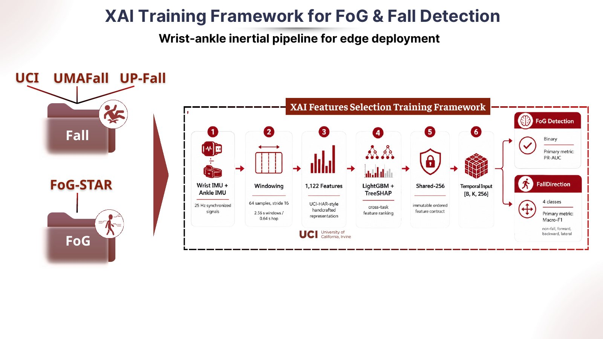

- **Data.** Falls from **UCI, UMAFall and UP-Fall**; freezing of gait from **FoG-STAR**. Wrist and ankle
  IMUs are synchronised at **25 Hz**.
- **Features you can explain.** Each 2.56 s window (64 samples, hop 0.64 s) becomes **1,122
  UCI-HAR-style features**. **LightGBM + TreeSHAP** ranks them across both tasks, and the top
  **256** become one fixed, ordered feature contract shared by training and firmware.
- **One model, two heads.** A **depthwise-separable temporal convolutional network (DS-TCN)** reads the
  last 10 windows (`[B, 10, 256]`): three dilated depthwise blocks (d = 1, 2, 4) with LayerNorm, GELU and
  residuals, then a **freezing-of-gait** head (sigmoid, binary, scored on PR-AUC) and a
  **fall-direction** head (softmax: no fall, forward, backward, lateral; scored on macro-F1).

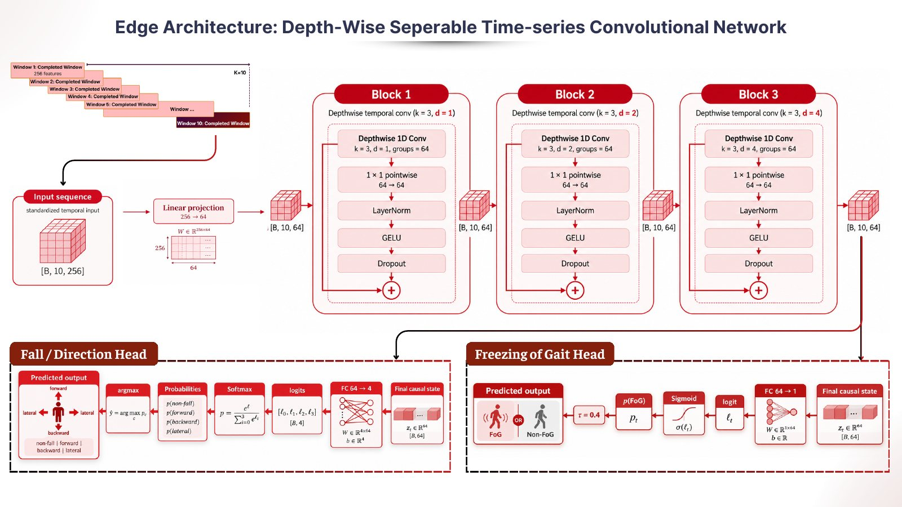

### Running it on the MVP accelerator

The EFR32xG26 has a **Matrix Vector Processor (MVP)** next to its Cortex-M33. TensorFlow Lite Micro
keeps control of the graph; the supported kernels (fully connected, conv, depthwise conv, add, mul)
are offloaded to the MVP, and everything else falls back to CMSIS-NN on the CPU.

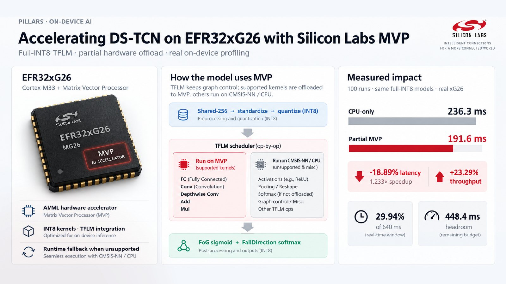

| Measured on a real xG26, 100 runs, same INT8 model | |
| :--- | ---: |
| CPU only | 236.3 ms |
| Partial MVP offload | **191.6 ms** (1.23× faster) |
| Share of each 640 ms window | **29.9 %**, leaving 448 ms of headroom |

### "Help", "good" and coughs, on MCU B

A **TENet12** keyword model (a small temporal-efficient CNN, INT8) listens on MCU B's microphone for four
classes: **help** (distress), **good** (all fine), **cough**, and **unknown** for everything else.
It was trained on English keywords from the Multilingual Spoken Words Corpus (4,437 "help" and
9,711 "good" clips), **COUGHVID** (EPFL, 30k+ recordings), and Silicon Labs MLTK's background speech for
"unknown". A spoken "help" goes out as an SOS.

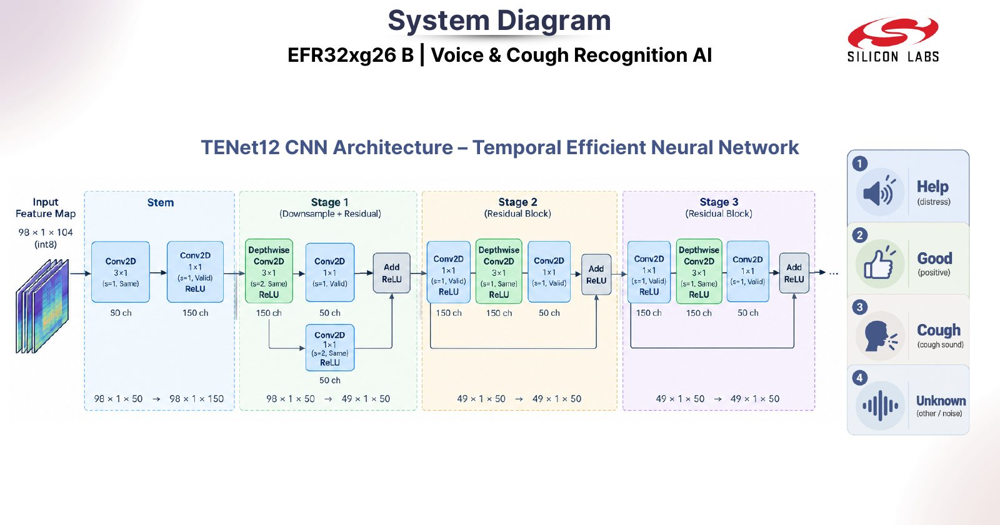

 

## 💊 The dispenser

Eight cups in two layers, one shared pickup cup at the front.

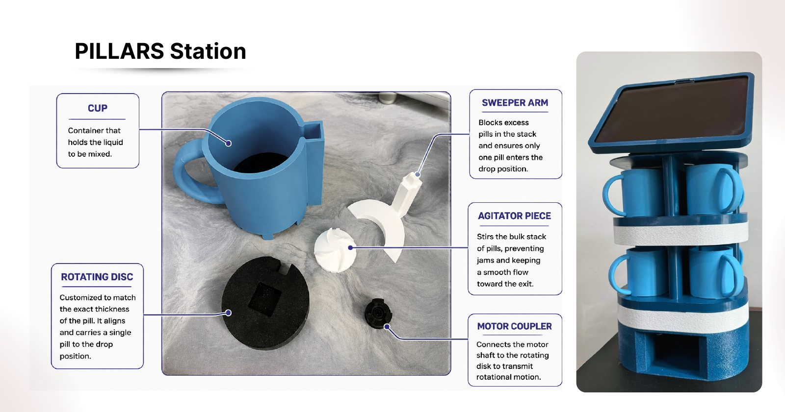

Each cup is a small 3D-printed pill feeder. A motor turns a **rotating disc** whose pocket is cut to the
thickness of that pill, so it carries exactly one pill at a time to the drop hole. A **sweeper arm**
blocks any extra pill riding on top, and an **agitator** stirs the stack so pills keep flowing instead
of bridging and jamming.

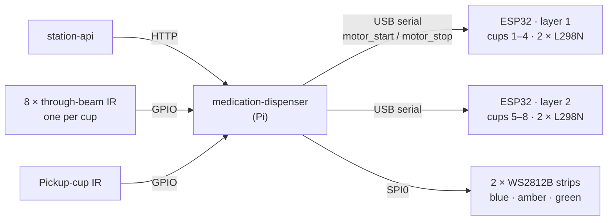

- **The ESP32s only turn motors.** Each one gets `motor_start` / `motor_stop` and runs a forward-back
  jog between them, so pills don't jam in the cup.
- **The Pi counts.** All nine IR sensors are wired straight to the Pi's GPIO. A background thread
  debounces each beam, counts pills per cup, and stops that cup's motor at the right count, or after
  a jam timeout with no new pill.
- **Every cup runs at once.** A dose of three medications turns three motors in parallel, across both
  layers, each stopping on its own count.
- **Did they actually take it?** After a dispense, the pickup-cup sensor arms. Lift the cup and the
  Station logs `medication.cup_removed`; leave it and it raises `medication.missed`, a P1 alert to the
  caregiver.
- **Tunable live.** Jog timing and motor power are set from a PIN-gated Control tab and applied on the
  next dispense, no restart. A set of bench scripts (identify sensors, identify motors, check
  direction, tune jog) made bring-up repeatable.

### Who gets pills, and when

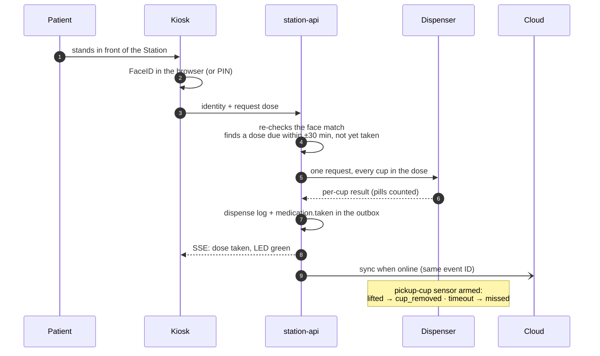

 

## 🖥️ The Station kiosk

A touch screen on the Station, designed for an older adult from across the room: big type, one thing
per tab, and the next dose always visible.

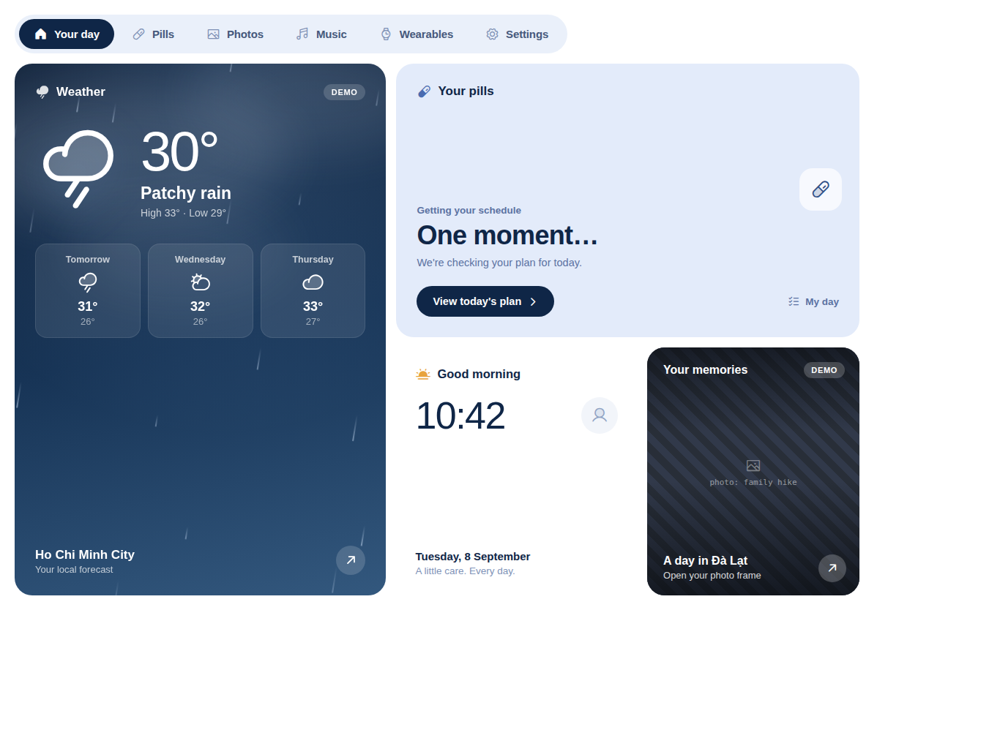

"Your day": weather, today's pills, the clock and a family photo frame, readable from across the room.

| Tab | What's on it |
| :--- | :--- |
| **Your day** | Clock, weather, today's pills, to-do list and a family photo |
| **Pills** | Each medication's schedule and stock, adherence, which cup holds what |
| **Photos** | A full-screen memory frame, with the time and next dose kept quiet in the corners |
| **Music** | A large-target player for the radio and old records |
| **Wearables** | Wrist and ankle battery, an ON/OFF mobility strip against dose times, fall detection status |
| **Settings** | Users, FaceID enrolment, sound, Control tab (PIN-gated: manual dispense, jog tuning, emergency stop) |

When a dose comes due, a full-screen alarm takes over, and the same reminder is pushed down to the
wristband over BLE so the patient feels it on the wrist too.

 

## 📱 The caregiver app

- **Onboarding**: create a patient, pair the Station by its device code, pick the wristband from a live
  Bluetooth radar of what the Station can see, record consent, enrol FaceID
- **Prescription to plan**: photograph a prescription; **Tesseract OCR** (Vietnamese + English) reads
  it and a text LLM structures it into an editable draft. Nothing is activated until a caregiver checks
  every line and assigns a cup
- **Live overview**: a **3D patient digital twin** (three.js) with the wrist and ankle sensors anchored
  on it, a movement safety dashboard, and realtime events as they happen
- **Alerts first**: fall and SOS jump to the top across both the Station and the caregiver app
- **Assistant**: answers questions about the patient's own logged data, scoped to that patient

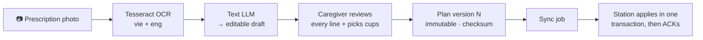

 

## 🔁 How an event travels

From a possible freeze on the wrist to a caregiver's screen:

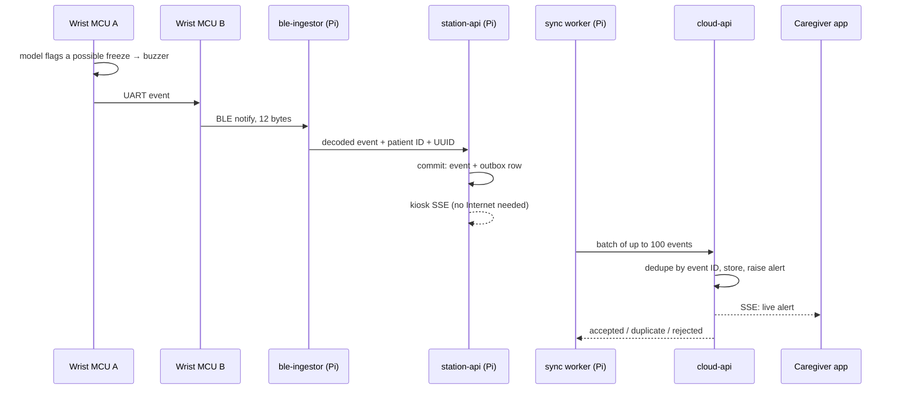

- **Written down first.** Nothing counts as received until it's in the Station's PostgreSQL. If the
  Internet drops, events wait in the outbox.
- **Retries are safe.** Every event carries one UUID for life; the Cloud rejects duplicates, so a retry
  never creates a second fall.
- **Config flows the other way the same way.** Patient profiles, face descriptors and medication plans
  go down as versioned, checksummed sync jobs; the Station applies each in one transaction and only
  then ACKs.

 

## 🔧 Problems that took the most iterations

<b>Who counts the pills: the ESP32 or the Pi?</b>

 

The first rig had each ESP32 read its own four IR sensors, count pills and decide when to stop. It
worked on the bench, but every tuning change meant reflashing two boards, and a miscount was invisible
to the Pi until the dispense was over.

So the split moved: **the ESP32s only turn motors**, and all IR sensors moved to the Pi's GPIO. The
Pi now owns debounce, counting and jam detection in one place, the HTTP contract to the rest of the
Station didn't change, and tuning became a config change instead of a firmware build.

The move came with its own lessons: a **common ground across everything** (Pi, both 12 V motor
supplies, all eight sensor rails), or the sensor lines float and read noise; a **voltage divider** on
each 5 V sensor before it touches a 3.3 V Pi pin; and **measuring each sensor's polarity one by one**,
because they weren't all the same.

<b>LEDs on a Raspberry Pi 5</b>

 

The usual `rpi_ws281x` library drives WS2812B through PWM and DMA via `/dev/mem`, which doesn't work
on the Pi 5's new RP1 chip. The strips are driven over **SPI0's MOSI line** instead. Two strips sit on
either side of the chute, Y-split from the same data pin, so they mirror each other: the pixel count
is 10, not 20, which only showed up on the bench when half of each strip stayed dark.

<b>One wristband, the right patient</b>

 

BLE packets carry no patient ID by design. The Cloud is the only source of truth for which wrist
belongs to whom, versioned and synced to the Pi before it connects. Dose reminders going *down* to
the wrist are checked twice: the command records the exact wrist it was meant for, and the BLE writer
re-checks the assignment right before writing. A reminder queued for a wrist that has since been
unpaired is dropped, never delivered to the new one.

<b>Reading a prescription without freezing the app</b>

 

The first version sent the photo to a vision model inside the request. It was slow, hit rate limits,
and froze the API while it waited. Reading now runs in a **background worker**: local Tesseract OCR
(no network, no per-call cost), then one small text-only LLM call to structure it. If the LLM is
unavailable, the caregiver still gets the OCR text to type from. Uploads also go **straight to the
API with a short-lived ticket**, after a proxy in the middle was found dropping 2 MB photos mid-transfer.

<b>A demo venue with no reliable Internet</b>

 

The whole point is that the home keeps working offline, but the *caregiver* side needs the Cloud. For
the live demo, the team built a **LAN-only Cloud** that runs on the local network, plus two scripts
that switch the Station between production and LAN demo without hand-editing config mid-demo.

 

## 🗓️ How it was built

Four months, from a pitch in May to the Grand Final on 18 September.

| When | Stage |
| :--- | :--- |
| **Month 1** | Wearable hardware MVP on Silicon Labs dev kits; fall and FoG dataset collection |
| **Month 2** | Fall / FoG and voice models trained; first wearable firmware; initial Pi station |
| **Month 3** | A fully working Raspberry Pi Station: BLE gateway, dispenser, kiosk, offline database |
| **Month 3 – 4** | Wearable, Station and Cloud joined end to end; caregiver app, pairing, realtime alerts |
| **Month 4** | Custom wristband and ankle PCBs, dispenser bring-up on real hardware, the 3D patient twin, prescription reading |
| **Final weeks** | Debugging on the real rig, the LAN-only demo fallback, rehearsing the full demo |

 

## 🧰 Stack

| Layer | Stack |
| :--- | :--- |
| **Wearable** | 2 × Silicon Labs EFR32xG26 (BRD2608A), BGM220 ankle node, Simplicity SDK, ICM-40627 IMU, GC9A01 round TFT, I²S mic, custom PCBs |
| **Edge AI** | LightGBM + TreeSHAP feature selection, DS-TCN (fall direction + FoG), TENet12 (keywords + cough), full-INT8 TensorFlow Lite Micro, MVP accelerator, Silicon Labs MLTK |
| **Dispenser** | 2 × ESP32 (PlatformIO, C), 4 × L298N, 8 DC motors, 9 IR sensors, 2 × WS2812B strips |
| **Station** | Raspberry Pi 5, Docker Compose, FastAPI, PostgreSQL, Redis (AOF), Bleak (BLE), Next.js kiosk, face-api.js |
| **Cloud** | FastAPI, PostgreSQL + Alembic, Redis, background worker, SSE, Tesseract OCR + an LLM via OpenRouter |
| **Caregiver app** | Next.js 15, React 19, three.js / React Three Fiber, Recharts, face-api.js |
| **Security** | HttpOnly JWT cookies with rotating refresh, per-patient access roles, hashed station tokens, encrypted face descriptors (no face images stored), short-lived SSE tickets |

 

| 👥 4 people | 🧱 3 tiers | 🔌 6 boards | 💊 8 cups |
| :---: | :---: | :---: | :---: |
| **~17k** lines of Python | **~14k** lines of TypeScript | **38** test files | **0** real patient data |

 

---

**[Bảo Trương](https://github.com/baotrq)** · with Đặng Như Phước, Huỳnh Trọng Khiêm and Hồ Minh Thao · Team MLIoT – Edgelectronix · FPT IoT Challenge 2026

